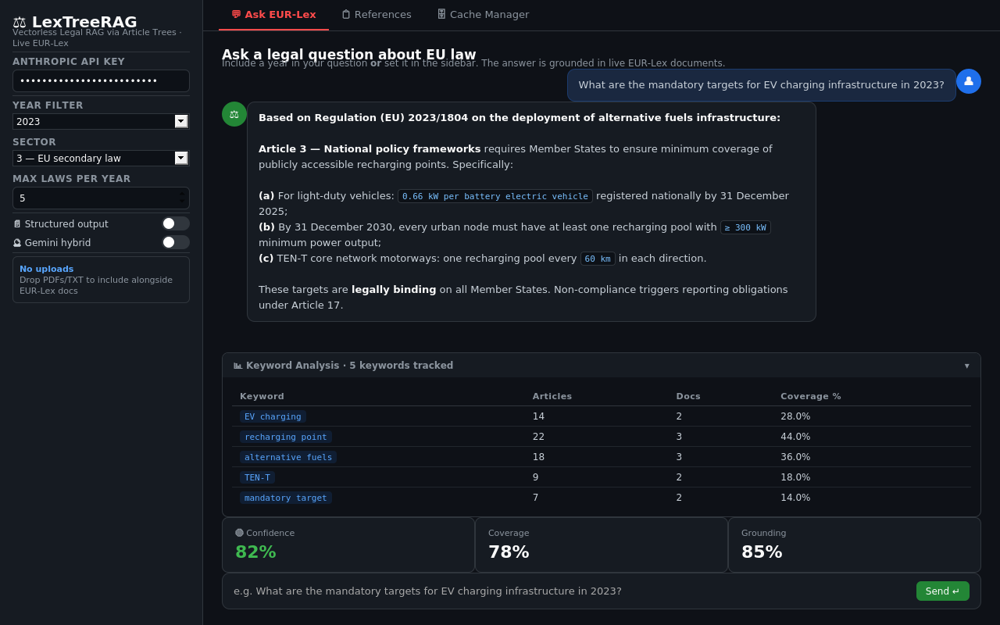
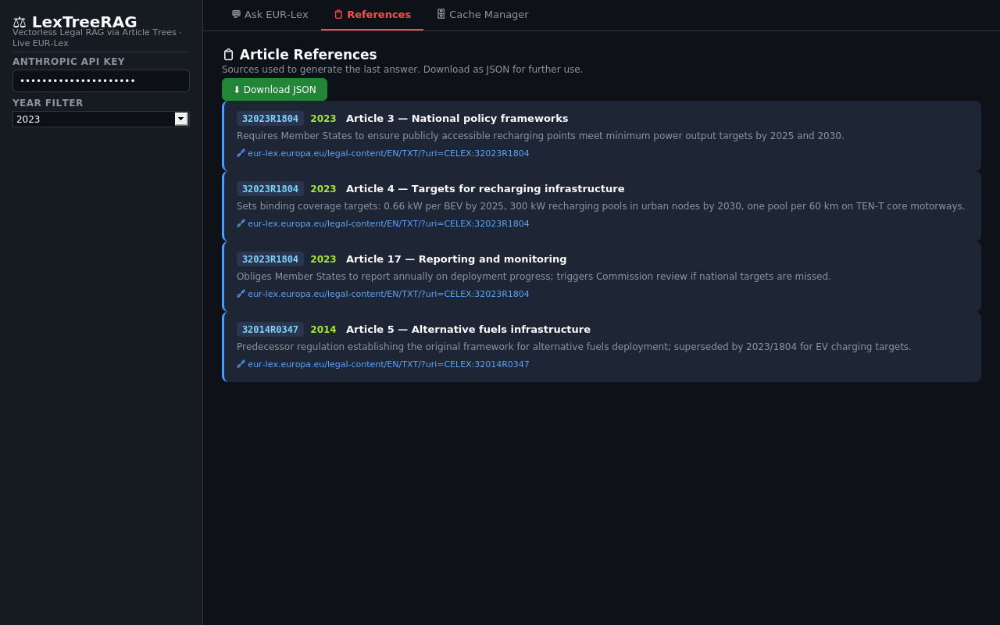
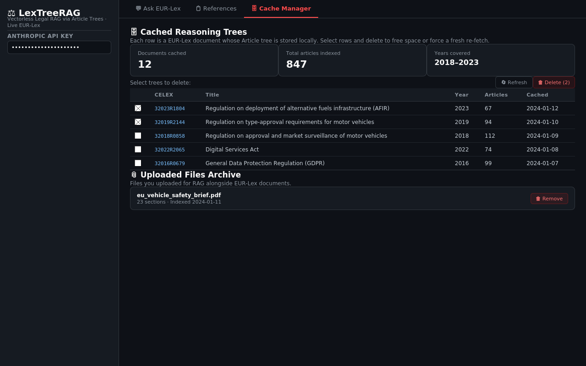

# ⚖️ LexTreeRAG

**Ask a question about EU law. Get an answer that cites the exact articles, pulled live from EUR-Lex.**

[](https://www.python.org/)
[](https://streamlit.io/)
[](https://www.anthropic.com/)
[](https://eur-lex.europa.eu/)
[](https://github.com/saeedm31/LexTreeRAG/actions/workflows/tests.yml)
[](LICENSE)

📖 **[Documentation](https://saeedm31.github.io/LexTreeRAG/)** · 🚀 **[Quick start](#-quick-start)** · 🧠 **[How it works](#-how-it-works)**



---

## 💡 Why it exists

EU law is huge, split across thousands of regulations, and written for lawyers.
Finding *which article* answers your question can take hours.

LexTreeRAG does that search for you:

- **Finds the right laws** — searches the official EUR-Lex database live, no manual browsing
- **Reads them like a lawyer** — navigates each regulation by its articles, the way you'd use a table of contents
- **Shows its sources** — every answer links back to the exact articles it used
- **Checks itself** — scores its own answer and retries with a wider search when confidence is low

> **Example:** *"What are the obligations of data controllers under GDPR?"*
> → finds Regulation (EU) 2016/679, picks the relevant articles, and returns a grounded answer with article references.

### Why no vector database?

Most RAG systems cut documents into chunks and search them with embeddings.
Laws already have a structure — articles, paragraphs, a clear index — so LexTreeRAG uses it.
The model reads a short "table of contents" of each regulation and picks the articles it needs.
That gives article-level precision with no embedding model and no vector DB to run.

---

## ✨ Features

- **Vectorless retrieval** — no embeddings, no vector DB
- **Live EUR-Lex search** via SPARQL on the CELLAR endpoint (free, no auth)
- **Smart search terms** — EU-domain synonyms (e.g. *motorcycle* → *motor vehicle, L-category*)
- **Confidence gate** — coverage and grounding scores, with up to 2 automatic retries
- **Keyword Discovery** — when retries fail, shows what was missed and suggests new terms
- **Structured answers** — optional Obligations / Rights / Definitions / Exceptions / Procedure view
- **Bring your own documents** — upload PDF, TXT or MD and query them alongside EUR-Lex
- **Local cache** — each law is downloaded and parsed once, then reused
- **Optional Gemini panel** — a second answer grounded in Google Search, for comparison

---

## 🧠 How it works

```
User Question
      │
      ▼
┌──────────────────────────────────────────┐
│  1. Keyword Extraction      (Haiku)      │
│  2. SPARQL Search  →  EUR-Lex CELLAR     │
│     Compound AND · synonym expansion     │
│  3. PDF Archive  (local, reused)         │
│  4. Article Tree Builder    (Haiku)      │
│     normalize → parse → sub-chunk        │
└────────────────────┬─────────────────────┘
                     │
          ┌──────────▼───────────┐
          │   5. Tree Navigator  │  ← no vectors
          │   slim tree (Haiku)  │    LLM picks articles
          │   scores 0–10        │    by relevance
          └──────────┬───────────┘
                     │
          ┌──────────▼───────────────────────┐
          │  6. Answer Generation            │
          │     Claude Opus (streaming)      │
          └──────────┬───────────────────────┘
                     │
          ┌──────────▼───────────────────────┐
          │  7. Confidence Gate   (Haiku)    │
          │     score < 50 OR coverage < 40  │
          │     → silent retry ×2            │
          │     → Keyword Discovery UI       │
          └──────────────────────────────────┘
```

1. **Search** — Haiku extracts search terms and the year; a SPARQL query finds matching laws on EUR-Lex. Original legislation is preferred over consolidated versions.
2. **Archive** — each PDF is saved locally on first download, so later queries need no network call.
3. **Article tree** — the PDF is cleaned and split into article nodes. Long articles are split into sub-nodes. Haiku writes a one-line summary for each.
4. **Navigate** — Haiku sees only the article IDs and summaries (~3,000 tokens for a 60-article law) and scores each one 0–10. Articles scoring 4+ move on.
5. **Answer and check** — Claude Opus streams the answer from the selected articles. Haiku then scores coverage and grounding. Low scores trigger a wider search, and the best answer wins.

Full details are in the [documentation](https://saeedm31.github.io/LexTreeRAG/) and [TECHNICAL_DOCS.md](TECHNICAL_DOCS.md).

---

## 🚀 Quick start

```bash
git clone https://github.com/saeedm31/LexTreeRAG.git
cd LexTreeRAG
pip install -r requirements.txt

cp .env.example .env        # add your ANTHROPIC_API_KEY
streamlit run app.py        # opens http://localhost:8501
```

Requires **Python 3.9+**.

### Configuration

| Variable | Required | Description |
|---|---|---|
| `ANTHROPIC_API_KEY` | ✅ | From [console.anthropic.com](https://console.anthropic.com/) |
| `GEMINI_API_KEY` | Optional | Turns on the Gemini comparison panel ([free tier](https://aistudio.google.com/)) |
| `CACHE_DIR` | Optional | Where article trees are stored (default `./data/cache`) |
| `PDF_ARCHIVE_DIR` | Optional | Where PDFs are stored (default `./data/pdfs`) |
| `MAX_LAWS_PER_YEAR` | Optional | Laws fetched per search (default `5`) |

### Command line

```bash
python main.py                                   # interactive
python main.py -q "What are GDPR obligations for data controllers?"
python main.py -q "..." --max-laws 10 --save-report
```

---

## 🖥️ The app

| | |
|---|---|
| **💬 Ask EUR-Lex** | Chat, confidence scores, keyword analysis |
| **📋 References** | Source cards with EUR-Lex links, JSON export |
| **🗄️ Cache Manager** | Browse cached laws and the PDF archive |

<details>
<summary>More screenshots</summary>




</details>

---

## 📁 Project structure

```
LexTreeRAG/
├── app.py                      # Streamlit web UI
├── main.py                     # CLI entry point
├── pipeline/
│   ├── keyword_extractor.py    # Search terms + year
│   ├── eurolex_client.py       # SPARQL search + CELLAR fetch
│   ├── pdf_archive.py          # Local PDF archive + inbox
│   ├── tree_builder.py         # Article tree parser
│   ├── tree_navigator.py       # LLM article selection
│   ├── answer_verifier.py      # Confidence scoring
│   ├── clause_ranker.py        # Obligation signal scoring
│   ├── doc_ingester.py         # Uploaded files → tree
│   ├── query_classifier.py     # Question type + sub-questions
│   └── gemini_search.py        # Optional Gemini layer
├── data/                       # Cache + PDF archive (gitignored)
└── tests/                      # 200+ unit tests, no API key needed
```

## ✅ Tests

```bash
pip install pytest
pytest -q
```

The tests run offline (no API calls) on every push with GitHub Actions. They cover article parsing, keyword and obligation-signal extraction, clause ranking, tree navigation and end-to-end retrieval scenarios on sample regulation text.

---

## ⚠️ Disclaimer

LexTreeRAG is a research and demo tool. Its answers are not legal advice — always check the cited articles.

## 🤝 Contributing

Pull requests are welcome. Please open an issue first for larger changes.

Built by [Saeed Hojjatpanah](https://github.com/saeedm31).
